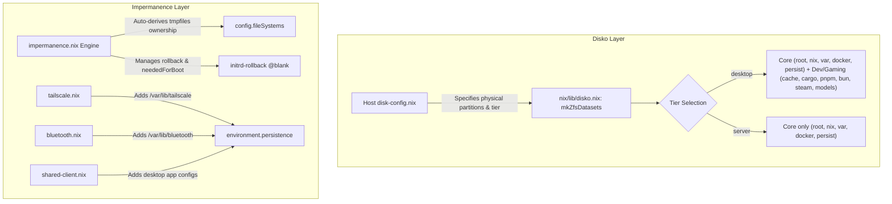

# Storage & Impermanence Refactoring: Migration Plan

A comprehensive architectural plan to refactor ZFS storage and Impermanence from duplicated, hardcoded lists into a scalable, DRY, multi-host foundation across **all** managed machines.

---

## 1. Context & Motivation

### Current Pain Points
1. **Verbatim Disko Duplication (~100 lines per host)**:
   * [hercules/disk-config.nix](file:///home/tghanken/Repos/os/nixos-config/nix/hosts/hercules/disk-config.nix) and [pegasus/disk-config.nix](file:///home/tghanken/Repos/os/nixos-config/nix/hosts/pegasus/disk-config.nix) share an identical ~90-line dataset block (`reserved`, `local/root`, `local/nix`, `local/var`, `local/docker`, `local/cache`, `local/cargo`, `local/pnpm`, `local/bun`, `local/steam`, `local/models`, `safe/persist`).
   * Updating snapshot options, mountpoints, or compression requires manual edits across every host file.
2. **Hardcoded Username (`tghanken`)**:
   * Username is embedded across Disko mountpoint paths (`/home/tghanken/.cache`, `/home/tghanken/.cargo`, etc.) and impermanence user blocks, making modules un-reusable for servers or other users.
3. **The "God Module" Impermanence Anti-Pattern**:
   * [impermanence.nix](file:///home/tghanken/Repos/os/nixos-config/nix/modules/nixos/impermanence.nix) centrally hardcodes paths for unrelated subsystems (Tailscale, Bluetooth, NetworkManager, Chrome, Spotify, Discord, Thunderbird).
   * Violates NixOS module encapsulation: headless servers evaluate client paths (e.g. Chrome/Bluetooth), and adding or modifying a service requires editing a separate storage module.
4. **Double Declaration of Paths & Permissions**:
   * Every dataset mountpoint under `/home/tghanken` is manually duplicated in `systemd.tmpfiles.rules` to assign `tghanken:users` ownership.
5. **No Distinction Between Workstations & Servers**:
   * Workstations (`hercules`, `pegasus`) need gaming (`steam`), local AI (`models`), and language caches (`cargo`, `pnpm`, `bun`).
   * Headless servers (`hades`, `zeus`, `poseidon`) only need core system, container, and persistence datasets.

---

## 2. Target Architecture



### Core Design Principles
* **Separation of Concerns**: Physical drive geometry (devices, ESP, swap size) lives in the host file; logical dataset topology lives in a shared generator.
* **Colocated Persistence**: Each service or profile declares its own persistent files and directories using NixOS's open module system (`environment.persistence."/persist"`).
* **Dynamic Permission Synthesis**: Permissions for user mountpoints are derived automatically by introspecting `config.fileSystems`.
* **Zero Duplication**: Shared dataset schemas and profile tiers allow adding a new host with ~25 lines of configuration instead of ~170 lines.

---

## 3. Implementation Blueprint

### Component 1: Shared Disko Generator (`nix/lib/disko.nix`)

A reusable library function producing the standardized dataset tree:

```nix
# Proposed interface in nix/lib/disko.nix
{
  mkZfsDatasets = {
    user ? "tghanken",
    profile ? "desktop", # "desktop" | "server"
    rootPool ? "zroot",
    extraDatasets ? {},
  }: {
    reserved = {
      type = "zfs_fs";
      options = {
        mountpoint = "none";
        refreservation = "15G";
      };
    };

    local = {
      type = "zfs_fs";
      options = {
        mountpoint = "none";
        "com.sun:auto-snapshot" = "false";
      };
    };

    "local/root" = {
      type = "zfs_fs";
      mountpoint = "/";
      options."com.sun:auto-snapshot" = "false";
      postCreateHook = "zfs list -t snapshot -H -o name | grep -E '^${rootPool}/local/root@blank$' || zfs snapshot ${rootPool}/local/root@blank";
    };

    "local/nix" = {
      type = "zfs_fs";
      mountpoint = "/nix";
      options = {
        atime = "off";
        "com.sun:auto-snapshot" = "false";
      };
    };

    "local/var" = {
      type = "zfs_fs";
      mountpoint = "/var";
      options."com.sun:auto-snapshot" = "false";
    };

    "local/docker" = {
      type = "zfs_fs";
      mountpoint = "/var/lib/docker";
      options."com.sun:auto-snapshot" = "false";
    };

    safe = {
      type = "zfs_fs";
      options = {
        mountpoint = "none";
        "com.sun:auto-snapshot" = "true";
      };
    };

    "safe/persist" = {
      type = "zfs_fs";
      mountpoint = "/persist";
      options."com.sun:auto-snapshot" = "true";
    };
  }
  // (lib.optionalAttrs (profile == "desktop") {
    "local/cache" = {
      type = "zfs_fs";
      mountpoint = "/home/${user}/.cache";
      options."com.sun:auto-snapshot" = "false";
    };
    "local/cargo" = {
      type = "zfs_fs";
      mountpoint = "/home/${user}/.cargo";
      options."com.sun:auto-snapshot" = "false";
    };
    "local/pnpm" = {
      type = "zfs_fs";
      mountpoint = "/home/${user}/.local/share/pnpm";
      options."com.sun:auto-snapshot" = "false";
    };
    "local/bun" = {
      type = "zfs_fs";
      mountpoint = "/home/${user}/.bun";
      options."com.sun:auto-snapshot" = "false";
    };
    "local/steam" = {
      type = "zfs_fs";
      mountpoint = "/home/${user}/.local/share/Steam";
      options."com.sun:auto-snapshot" = "false";
    };
    "local/models" = {
      type = "zfs_fs";
      mountpoint = "/data/models";
      options."com.sun:auto-snapshot" = "false";
    };
  })
  // extraDatasets;
}
```

### Component 2: Host Disko File Simplification

Host `disk-config.nix` files focus strictly on physical disks and vdev topology:

```nix
# Example: nix/hosts/hercules/disk-config.nix (reduced from ~170 lines to ~35 lines)
{ flake, ... }: {
  disk = {
    primary = { /* NVMe 1 partition definition */ };
    secondary = { /* NVMe 2 partition definition */ };
  };
  zpool.zroot = {
    type = "zpool";
    mode.topology.vdev = [{ members = ["primary" "secondary"]; }];
    rootFsOptions = {
      xattr = "sa";
      compression = "lz4";
      atime = "off";
      recordsize = "64K";
      "com.sun:auto-snapshot" = "false";
    };
    options = {
      ashift = "12";
      autotrim = "on";
    };
    mountpoint = null;
    datasets = flake.lib.disko.mkZfsDatasets {
      profile = "desktop";
      user = "tghanken";
    };
  };
}
```

### Component 3: Decentralized Persistence

Move persistence rules out of `impermanence.nix` into their respective domain modules:

| Subsystem / Service | Owning File | Declarative Persistence |
| :--- | :--- | :--- |
| **Tailscale** | [nix/modules/nixos/tailscale.nix](file:///home/tghanken/Repos/os/nixos-config/nix/modules/nixos/tailscale.nix) | `environment.persistence."/persist".directories = [ "/var/lib/tailscale" ];` |
| **Bluetooth** | [nix/modules/nixos/bluetooth.nix](file:///home/tghanken/Repos/os/nixos-config/nix/modules/nixos/bluetooth.nix) | `environment.persistence."/persist".directories = [ "/var/lib/bluetooth" ];` |
| **Networking** | [nix/modules/nixos/networking.nix](file:///home/tghanken/Repos/os/nixos-config/nix/modules/nixos/networking.nix) | `environment.persistence."/persist".directories = [ "/etc/NetworkManager/system-connections" ];` |
| **Desktop Client Apps** | [nix/modules/profiles/shared-client.nix](file:///home/tghanken/Repos/os/nixos-config/nix/modules/profiles/shared-client.nix) | `environment.persistence."/persist".users.${user}.directories = [ ".config/spotify" ".config/discord" ".config/google-chrome" ".thunderbird" ];` |
| **Core Base OS** | [nix/modules/nixos/impermanence.nix](file:///home/tghanken/Repos/os/nixos-config/nix/modules/nixos/impermanence.nix) | `/etc/machine-id`, `/etc/ssh/ssh_host_*`, `/var/log`, `/var/lib/nixos`, `/var/lib/systemd`, user Repos, Documents, `.ssh`, `.gnupg`, shell history |

### Component 4: Dynamic User & Mountpoint Tmpfiles Synthesis

In [nix/modules/nixos/impermanence.nix](file:///home/tghanken/Repos/os/nixos-config/nix/modules/nixos/impermanence.nix):

1. **Configurable Primary User**:
   ```nix
   options.services.impermanence.user = mkOption {
     type = types.str;
     default = "tghanken";
     description = "Primary user whose home directory is managed under impermanence";
   };
   ```
2. **Auto-Generated Tmpfiles**:
   ```nix
   # Dynamically find all filesystems mounted inside /home/<user> or /data
   systemd.tmpfiles.rules =
     let
       userHome = "/home/${cfg.user}";
       managedMounts = lib.filterAttrs (mp: _: lib.hasPrefix userHome mp || mp == "/data/models") config.fileSystems;
     in
     [
       "d ${userHome} 0700 ${cfg.user} users -"
       "d ${cfg.persistPath}${userHome} 0700 ${cfg.user} users -"
     ]
     ++ (lib.mapAttrsToList (mp: _: "d ${mp} 0755 ${cfg.user} users -") managedMounts);
   ```

---

## 4. Step-by-Step Migration Phases

### Phase 1: Disko Generator Library
* [ ] Create `nix/lib/disko.nix` exporting `mkZfsDatasets`.
* [ ] Integrate into `nix/lib/default.nix` so it is accessible across all host modules.
* [ ] Refactor [hercules/disk-config.nix](file:///home/tghanken/Repos/os/nixos-config/nix/hosts/hercules/disk-config.nix) to use `mkZfsDatasets { profile = "desktop"; }`.
* [ ] Refactor [pegasus/disk-config.nix](file:///home/tghanken/Repos/os/nixos-config/nix/hosts/pegasus/disk-config.nix) to use `mkZfsDatasets { profile = "desktop"; }`.
* [ ] Verify: `nix eval .#nixosConfigurations.hercules.config.system.build.diskoScript` and `nix flake check --no-build`.

### Phase 2: Decentralize Impermanence
* [ ] Add `mkIf config.services.impermanence.enable` blocks into domain modules:
  * [tailscale.nix](file:///home/tghanken/Repos/os/nixos-config/nix/modules/nixos/tailscale.nix)
  * [bluetooth.nix](file:///home/tghanken/Repos/os/nixos-config/nix/modules/nixos/bluetooth.nix)
  * [networking.nix](file:///home/tghanken/Repos/os/nixos-config/nix/modules/nixos/networking.nix)
  * [shared-client.nix](file:///home/tghanken/Repos/os/nixos-config/nix/modules/profiles/shared-client.nix)
* [ ] Strip domain-specific paths from [impermanence.nix](file:///home/tghanken/Repos/os/nixos-config/nix/modules/nixos/impermanence.nix).
* [ ] Verify: inspect `nixosConfigurations.hercules.config.environment.persistence."/persist"` to confirm identical merged path resolution.

### Phase 3: Dynamic Tmpfiles Rules
* [ ] Add `user` option to `services.impermanence`.
* [ ] Replace hardcoded tmpfiles list with dynamic `config.fileSystems` introspection.
* [ ] Verify: inspect `nixosConfigurations.hercules.config.systemd.tmpfiles.rules` to confirm all user dataset mount points receive proper permissions.

### Phase 4: Server Fleet Rollout (`hades`, `zeus`, `poseidon`, `arges`, `brontes`, `steropes`)
* [ ] Refactor server `disk-config.nix` files to use `mkZfsDatasets { profile = "server"; }`.
* [ ] Ensure servers only mount `root`, `nix`, `var`, `docker`, and `persist`.
* [ ] Verify: evaluate disko scripts for all server configurations.

### Phase 5: Live Host Re-image Runbook
1. Execute pre-reimage backups (`rsync` of `Repos`, `.ssh`, `.gnupg`, host keys) on target host.
2. Deploy via `nixos-anywhere --flake .#<host> root@<installer-ip>`.
3. Verify `@blank` rollback and persistence integrity upon reboot.

---

## 5. Verification & Rollback Strategy

* **Evaluation Invariants**:
  Every phase must produce zero breaking changes on:
  ```bash
  nix flake check --no-build
  nix eval .#nixosConfigurations.hercules.config.system.build.toplevel
  nix eval .#nixosConfigurations.pegasus.config.system.build.toplevel
  nix eval .#nixosConfigurations.hades.config.system.build.toplevel
  ```
* **Disko Equivalence Test**:
  The generated disko mount scripts before and after refactoring must produce identical mount points and options.
* **VCS Safety**:
  Use `jj` revisions per phase to allow instant rollback to `c1a58f6e` if evaluation drifts.
